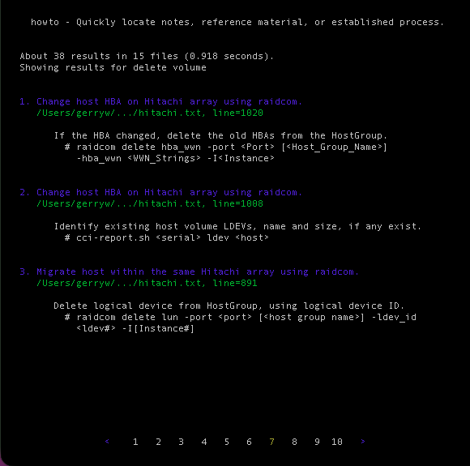

# howto

  

Here's a tool which allows you to quickly locate notes, process, or established procedure to produce repeatable results, much like a man page in Linux. The information contained is very similar to the implementation section of a runback, like the PDF versions I relied on at Sun Microsystems. Those were a collection of equipment guides for the SAN products we installed, used primarily to document the configuration, an implementation guide, and a customer deliverable. It helped our team to provide consistent installs, and a documentation trail for future reference.

I found the idea of keeping a storage runback very helpful, and one way to quickly recall steps for all storage tasks, invaluable for infrequent tasks that without this, would require a quickly search through notes, or contacting other storage engineers in our group for assistance. That peer support quickly vanished once I left Sun and started working as one of the principal storage admins managing block storage at large corporations.

With the development of the lookup tool for recalling work, documenting storage changes, impromptu notes, etc. It also proved to be invaluable for backing out changes, or troubleshooting after the fact. I thought why not take that same tool and retool it to provide that same speed of access, ability to search using multiple keys, to recall storage tasks, just like a runback, both to document the changes, and follow the same sequence of steps to guarantee consistent results with minimal risk to the environment. With that idea, the howto script was born, becoming one of the most valuable items in my tool belt.

## File Structure

* Create a folder titled HowTo in the Documents folder. This will contain all of the files with the data to be saved and searched. Create a text file with the of the content it will contain, using the format "name.txt". I used vendor names, since this was used to document processes unique to each vendor.
* This will be a Linux, not Windows ASCII text file, using LF instead of CR/LF at the end of every line. Content is stored and retrieved as articles, and article sections. An article can contain multiple sections, or none. All date, article and section markers should be entered between 2 blank lines, to help the search engine parse content.
* The first entries for each procedure should contain the Title, Date, and Tags, following by a brief description. The date was always updated anytime changes were made, to reflect the age of the information. Tags were added to include key words used to describe this procedure, basically words that may not exist within the content, but may be used to reference this and other similar articles.
* Be sure to end each article with a line beginning with 2 dashes, ie. "--", to separate this from other articles or procedures in this file. Make sure the last article also ends with a line with beginning with 2 dashes.

hitachi.txt

    Title: Add a SAN volume on Hitachi array using raidcom.
     Date: 09-Dec-2025
     Tags: admin, replicationn
     
    Create new SAN volumes on the Hitachi array and map to a host...
    
    --

    Title: Create a Shadow Image on Hitachi array using raid com.
     Date: 08-Dec-2025
     Tags: admin, replication, create, shadowimage

    Shadow Image is used to create a Point-in-Time copy of host volumes...

    --
  
## How to Search

To perform a search, enter one or more keywords after the lookup command. Use more keywords to narrow down the number of hits, otherwise you'll end up with a large list to review. The order of keywords is critical, ie. the results will be all articles containing keyword1, and from those results, all articles containing keyword2, etc. You also have the option to search for all articles not containing a keyword by attaching a "-" in front of that word.

## Scanning Hits and Selecting Article to View

The hits are displayed as a list of numbered results. Each hit will show the title, filename, keyword hit line number, and a short 2-3 line excerpt containing one or more keywords. Below this list, on the bottom edge of the screen is the list of pages of hit results. The height of the terminal window determines how many results are shown per page, which then determines the number of pages.

The terminal screen dimensions can be changed, to display more content by increasing the height, or displaying document tables without cutting off the right edge by increasing the width, or both. If the dimensions are changed while reading a document, you will need to exit that document and re-enter, in order for the word wrap function to adjust to the new dimensions.

To advance to the next page of hits, press the <code>&lt;spacebar&gt;</code>, press <code>b</code> to go back, or <code>q</code> to quit and exit.

To open up a result to view, enter the number next to it. Once inside, press the letter <code>n</code> to go to the next keyword instance, or <code>p</code> to go back to the previous one. Use the <code>&uparrow;</code> and <code>&downarrow;</code> to move one line up or down, and <code>q</code> to quit and return to the current page of search results.

Mode | Key | Action
:--: | :--: | :--:
List | <code>#</code> | Open Article
List | <code>&lt;spacebar&gt;</code> | Next Page
List | <code>p</code> | Prev Page
List | <code>q</code> | Quit and Exit
<space> | <space> | <space>
View | <code>n</code> | Next Keyword Hit
View | <code>p</code> | Prev Keyword Hit
View | <code>&uparrow;</code> | Prev Line
View | <code>&downarrow;</code> | Next Line
View | <code>q</code> | Quit and Return

